# RELIEF — Complete Project Documentation

**Team CareCatalysts · Agentathon 2026 · PES University**
Repository: `Kayamsaikrishna/relief` · Status: working prototype (not production grade)

---

## 1. What RELIEF is

When a patient under Ayushman Bharat PM-JAY / Arogya Karnataka is refused cashless treatment, a hospital desk or a community facilitator has to work out *why* and what to do next. RELIEF is an AI agent that helps with that:

1. reads the case (card, refusal reason, referral, bills, uploaded documents);
2. runs checks in code (records, referral, hospital empanelment, pre-authorisation clock, documents, improper charges);
3. finds the most likely **blocker** out of six;
4. retrieves and **cites** the rule that supports it;
5. drafts a fix (letter, checklist, escalation note, alternative hospitals);
6. **stops and waits for a human to approve, edit or reject** before anything is sent.

### What it will not do
- Give medical advice or judge medical necessity.
- Decide whether a person is eligible for the scheme.
- Guess. "Unknown" is a valid answer everywhere; weak evidence leads to a hand-over to a human.
- Act without approval. Every outward action needs a signed-in human decision.
- Handle emergencies. If wording suggests one, it stops and shows a fixed notice (call 112).

---

## 2. The six blockers

| Blocker | Meaning | Typical fix prepared |
|---|---|---|
| `REFERRAL` | Missing, invalid or wrong-tier referral | Referral checklist / request letter |
| `ENTITLEMENT` | Card or beneficiary record mismatch | Records-correction checklist |
| `LINKAGE` | Aadhaar / family-ID / card linkage issue | Linkage steps |
| `IMPROPER_CHARGE` | Hospital asked for payment for a covered package | Complaint/escalation letter citing the rule |
| `EMPANELMENT` | Hospital not empanelled for the package | List of alternative empanelled hospitals |
| `FORMS` | Pre-auth form or documents incomplete or late | Document checklist, clock status |

Two non-diagnoses: `ESCALATION_ONLY` (no fault found; go to the grievance route) and `INSUFFICIENT_EVIDENCE` (hand over, ask for more documents).

---

## 3. Architecture

See diagram **F1** in section 15.


### 3.1 Bounded-agent design
Code computes every fact. The local model may only (a) choose the order of checks, (b) rank candidate blockers that code already produced, and (c) write one summary sentence. If Ollama is down or its reply is invalid, a deterministic fallback runs and the trace shows a `fallback` event. The model cannot invent a blocker, a rule or an action.

### 3.2 Agent graph (LangGraph `StateGraph`)
Nodes: `intake → choose_tool ⇄ run_tool → retrieve → diagnose → plan → verify → human_gate → act_track → finalize`, with hand-over branches `handover_insufficient`, `handover_low`, `handover_verify`.

- `intake` stops immediately on emergency wording.
- `choose_tool`/`run_tool` loop over applicable tools (bounded step count).
- `diagnose` builds candidates from evidence; weak or no evidence ends in hand-over.
- `plan` drafts the fix; `verify` checks it (see 3.3) and can send it back to `plan` a limited number of times.
- `human_gate` uses LangGraph `interrupt()`; the run is checkpointed in SQLite (`SqliteSaver`, WAL) and resumed with `Command(resume=decision)`.
- `act_track` runs only after approval: records the simulated submission and creates follow-up reminders.

### 3.3 Verifier (code, not model)
Rejects a plan if it: cites no rule or an unknown rule/evidence ID; contains forbidden wording (eligibility or medical claims); or contradicts the evidence. A failing plan is revised or handed over — never shown as approved.

### 3.4 Tools (`src/relief/tools/`)
| File | Purpose |
|---|---|
| `ocr.py` | Tesseract OCR of uploaded images, field parsing, date normalisation (ISO and day-first) |
| `records.py` | Compare card data with documents (name/ID normalisation) |
| `referral.py` | Referral validity and tier check |
| `registry.py` | Hospital empanelment and package lookup, alternatives |
| `clock.py` | Pre-authorisation time-limit check |
| `forms.py` | Required-document check |
| `letters.py` + `templates/*.j2` | Jinja letters: checklist, escalation, hospital list |
| `rules_kb.py` | Rule search: embeddings (`ollama` nomic-embed-text, optional `bge`, or `hashing` for tests) over ChromaDB |

### 3.5 Rule base
`data/rules/rules.json` holds **31 paraphrased rules** from six official documents listed in `data/rules/sources.json`:
CAG Report 11 of 2023; NHA HBP 2.2 guidelines; PM-JAY Operation Manual 2022; WHO paper on Karnataka's Online Referral System (2025); NHA Grievance Redressal OM (Dec 2021); PM-JAY process flow.
Quotes are **unchecked** until `scripts/verify_sources.py` is run with internet access. Sources disagree on the pre-auth time limit (HBP 2.2: 6 h; CAG: 12 h), so both are shown.

---

Graph diagram: **F3**; code-vs-model split: **F4**; diagnosis: **F8**; verifier loop: **F9**.

---

## 4. Data model (SQLite)

Entity diagram: **F10**.

| Table | Key columns |
|---|---|
| `cases` | case_id, created_at, status, main_blocker, synthetic, case_json (+ created_by, error) |
| `decisions` | case_id, ts, action, decided_by, note |
| `submissions` | case_id, ts, kind, reference, payload_json, simulated |
| `users` | email (unique), name, role (`admin`/`facilitator`), password_hash, active, last_login |
| `audit` | ts, actor, action, case_id, detail |
| `reminders` | case_id, due_at, message, state, fired_at |

Types (Pydantic, unknown fields rejected) are in `src/relief/contracts/schemas.py`. `CaseStatus`: running, awaiting_approval, handover, approved, rejected, completed, error.

---

## 5. Backend API

All routes are under `/api`, JSON, `Authorization: Bearer <token>` except health and login. Interactive docs: `/api/docs`.

| Method & path | Purpose | Access |
|---|---|---|
| `GET /health` | Liveness | public |
| `POST /auth/login` | Email + password → JWT (throttled) | public |
| `GET /auth/me` · `POST /auth/password` | Current user · change password | user |
| `GET /registry/hospitals\|packages\|info` | Registry lookups | user |
| `POST /uploads` | Upload png/jpg/tif/bmp (content-checked, size-limited) | user |
| `POST /cases` | Create case; returns **202**, analysis runs in background | user |
| `GET /cases` | List (filters: status, blocker, q) | user (own) / admin (all) |
| `GET /cases/{id}` | Case result (poll for progress) | owner/admin |
| `POST /cases/{id}/decision` | `approve`, `edit` (needs `edited_plan`, re-verified), `reject`; decider = signed-in user | owner/admin |
| `GET /cases/{id}/log` | Trace and decision log | owner/admin |
| `GET /stats` · `GET /reminders` · `POST /reminders/{id}/done` | Dashboard data, reminders | user |
| `GET\|POST /admin/users`, `PATCH /admin/users/{id}` | User management | admin |
| `GET /admin/rules\|audit\|system` | Rule base, audit log, system status | admin |

Security: scrypt password hashes, HS256 JWT (secret auto-generated in `var/jwt.secret` if not set), login throttling, per-owner case privacy, audit log of sign-ins and decisions, CORS limited to configured origins, uploads validated by content.

---

## 6. Frontend (React 18 + Vite + TypeScript)

Libraries: react-router-dom, lucide-react, Plus Jakarta Sans (Fontsource). Hand-written CSS design system; palette from the logo (ink `#0a423c`, orange `#fe772c`, green `#65d25d`).

| Area | Pages |
|---|---|
| Public | Landing, Safety, Login |
| Signed-in | Dashboard, Cases (search/filter), New case (4-step wizard), Case detail (findings, cited rules, plan, live trace, approve/edit/reject), Reminders, Account |
| Admin | Overview, Users, Rules, Registry, Audit, System |

Structure: `src/api` (client, types) · `src/auth` (context, route guard) · `src/components` (ui, charts) · `src/layouts` · `src/pages/{public,app,admin}` · `src/styles` · `public/brand` (logo, icon, posters).

---

## 7. Repository layout

```
relief/
├─ src/relief/
│  ├─ agent/      graph, diagnosis, planner, verifier, safety, service, executor, run (CLI)
│  ├─ app/        api, auth, db, cli, executor, portal (simulator), scheduler
│  ├─ tools/      ocr, records, referral, registry, clock, forms, letters, rules_kb, templates/
│  ├─ llm/        Ollama client (JSON-schema constrained replies)
│  ├─ contracts/  Pydantic schemas
│  ├─ eval/       30 synthetic cases, run_eval
│  └─ config.py   settings + .env loader
├─ frontend/      React app (src/, public/, vite.config.ts)
├─ data/          registry/registry.json, rules/{rules,sources}.json
├─ fixtures/      sample case inputs
├─ scripts/       ollama_check.py, verify_sources.py
├─ tests/         48 tests
├─ docs/          CONTRACTS, LIMITS, EVALUATION(+RESULTS), REGISTRY_FORMAT, TEAM_GITHUB_PLAYBOOK, PREPARED_BEFORE_EVENT, this file
├─ .github/       CI workflow (Python tests + frontend build), PR/issue templates, CODEOWNERS
├─ Makefile · start.bat · start.sh · pyproject.toml · .env.example
```

---

## 8. Setup and run

**Requirements:** Python 3.11+ (tested on 3.13), Node 18+, Ollama, Tesseract (for OCR on real images).

### Windows
```bat
pip install -e ".[dev]"
copy .env.example .env
ollama pull nomic-embed-text
python scripts\ollama_check.py
python -m relief.app.cli create-user --email you@example.com --name "Your Name" --role admin
cd frontend && npm install && npm run build && cd ..
python -m uvicorn relief.app.api:create_app --factory --port 8000
```
Or run `start.bat`. Open http://127.0.0.1:8000.

### macOS / Linux
`make setup && make check && make user EMAIL=... NAME="..." ROLE=admin && make web && make serve`

### Frontend development
`make web-dev` (Vite on :5173, proxies `/api` to :8000).

### Other commands
`make test` (pytest) · `make eval` (evaluation) · `make demo` (CLI demo, no model).

### Configuration (`.env`)
| Variable | Default | Notes |
|---|---|---|
| `RELIEF_LLM_HOST` | `http://localhost:11434` | Ollama |
| `RELIEF_LLM_MODEL` | `qwen2.5:7b` | Must appear in `ollama list`; `qwen3:8b` is the design target |
| `RELIEF_LLM_TIMEOUT_S` | 180 | |
| `RELIEF_EMBEDDER` | `ollama` | or `bge`, `hashing` |
| `RELIEF_EMBED_MODEL` | `nomic-embed-text` | |
| `RELIEF_DATA_DIR`, `RELIEF_VAR_DIR`, `RELIEF_REGISTRY_PATH` | `data`, `var`, `data/registry/registry.json` | |
| `RELIEF_API_HOST` / `PORT` | `127.0.0.1` / `8000` | |
| `RELIEF_TOKEN_HOURS`, `RELIEF_JWT_SECRET` | 10, empty (auto) | |
| `RELIEF_CORS_ORIGINS` | localhost:5173 | |
| `RELIEF_MAX_UPLOAD_MB` | 10 | |

---

## 9. Typical user flow

1. Sign in (admin creates facilitator accounts under Admin → Users).
2. **New case:** enter card and refusal details, referral, any payment request, upload documents, review and submit.
3. The case runs in the background; the detail page shows live progress and the trace.
4. Review: main blocker, confidence, cited rules, evidence, drafted plan and letters.
5. **Approve**, **Edit** (re-verified) or **Reject**. Approval records a *simulated* submission and creates reminders.
6. Reminders and the audit log keep the follow-up and history.

---

## 10. Testing and evaluation

- **48 automated tests:** tools, verifier, LLM client (against a fake Ollama server, including embeddings), agent graph (scripted LLM), API (auth, ownership, admin, uploads), evaluation.
- **Evaluation (rule-based path, 30 synthetic cases):** agent 30/30 top-1 vs keyword baseline 11/30; 0 plans with forbidden wording; all plans cited a rule or handed over. These scores are **circular** (the rule-based path implements the same rules the answer keys come from) and show consistency, not real-world accuracy. See `docs/EVALUATION.md`.

---

## 11. Known limits (honest list)

1. Qwen and BGE were never run in the build sandbox; the Ollama client was tested against a fake server. Run `python scripts/ollama_check.py` and `python -m relief.eval.run_eval --llm` on your machine.
2. Rule quotes are unchecked until `scripts/verify_sources.py` is run.
3. Referral tiers come from a 2025 WHO paper and may have changed.
4. OCR was tested on generated images only; poor phone photos will often be "unreadable" and handed over.
5. The hospital registry and all cases are **synthetic**; the portal is a labelled simulator. No real patient data, no live TMS portal.
6. Python tested on 3.13 only; English only; not a legal or medical tool.
7. Prototype: no HTTPS termination, rate limiting beyond login throttling, backups, or multi-node deployment.

---

## 12. Team and GitHub workflow

| Member | GitHub |
|---|---|
| Kayam Sai Krishna (owner, team lead) | Kayamsaikrishna |
| M. Ramya Sree Lakshmi | MRamyasreelakshmi |
| Rishitha Reddy Aggannagari | rishithareddyaggannagari-cmd |
| Mahitha P | mahithap09 |

Branch per feature, small pull requests with review, CI on every PR (Python tests + frontend build), CODEOWNERS for review routing. Commit history must reflect real work during the event (31 Oct 4:00 PM – 1 Nov 3:30 PM, 2026). See `docs/TEAM_GITHUB_PLAYBOOK.md` and `CONTRIBUTING.md`.

---

## 13. Future work
Verified rule quotes and real source versions; real (permitted) registry data; OCR hardening and multilingual (Kannada) support; model evaluation with Qwen3 and real-world cases reviewed by domain experts; deployment hardening; integration with official channels only if authorised.

---

## 14. Sources
- CAG Report No. 11 of 2023, PM-JAY performance audit
- NHA, National Health Benefit Package 2.2 User Guidelines (Nov 2021)
- NHA, Operation Manual for AB PM-JAY (Apr 2022)
- WHO, Online Referral System in Karnataka's state health insurance scheme (2025)
- NHA, Grievance Redressal Guideline OM (Dec 2021)
- PM-JAY process flow at empanelled hospitals (2019)

Full URLs: `data/rules/sources.json`.

---

## 15. Flow diagrams (Mermaid)

These render on GitHub, VS Code (Markdown preview) and mermaid.live.

### F1. System architecture
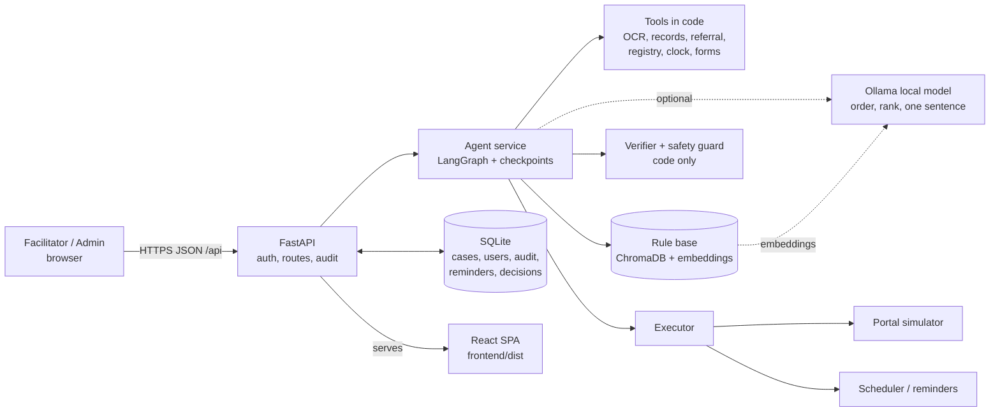

### F2. End-to-end user journey
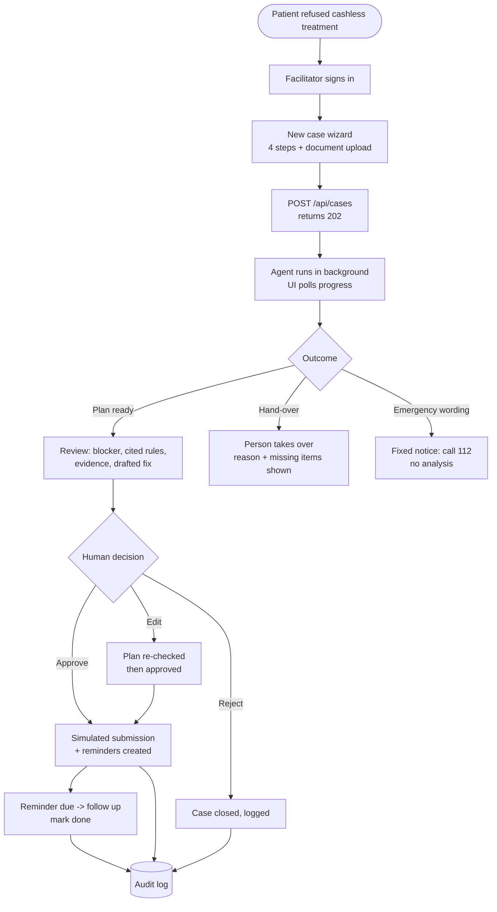

### F3. Agent graph (LangGraph)
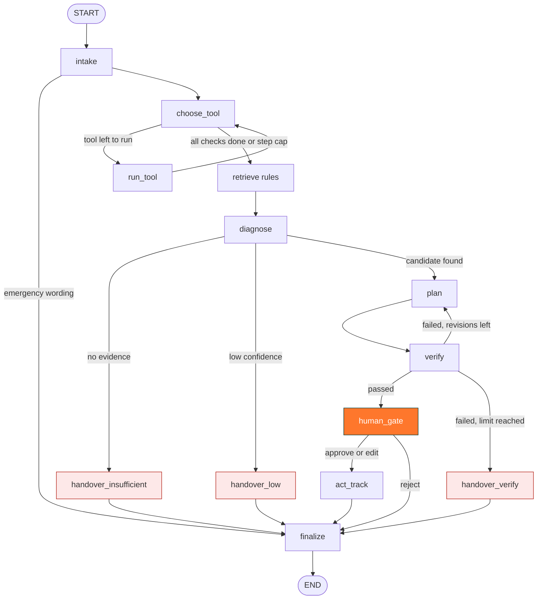

### F4. Who decides what: code vs model
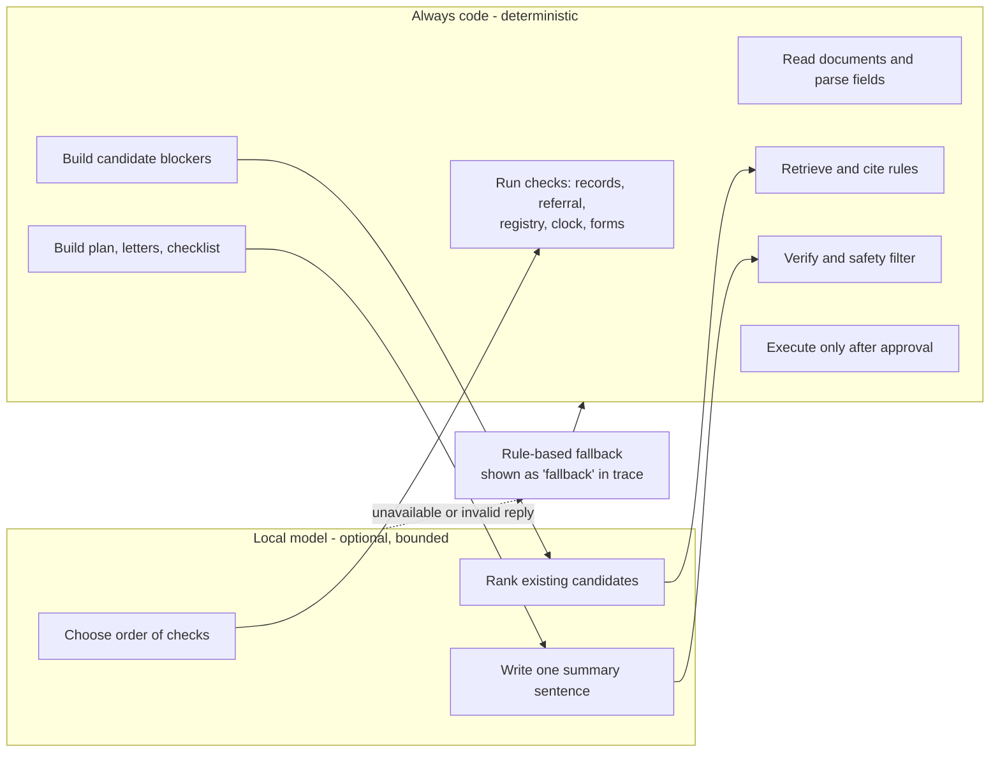

### F5. Case lifecycle (status)
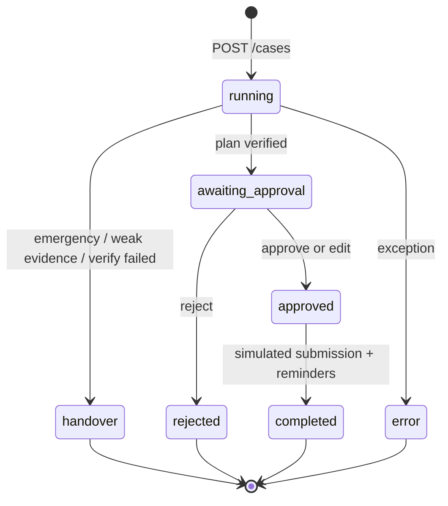

### F6. Create case and approve (sequence)
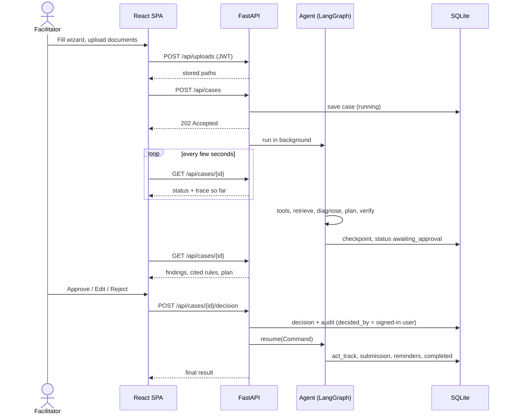

### F7. Sign-in and access control
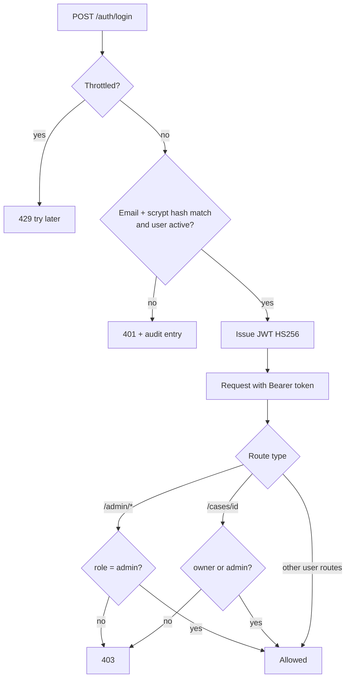

### F8. Diagnosis: from evidence to blocker
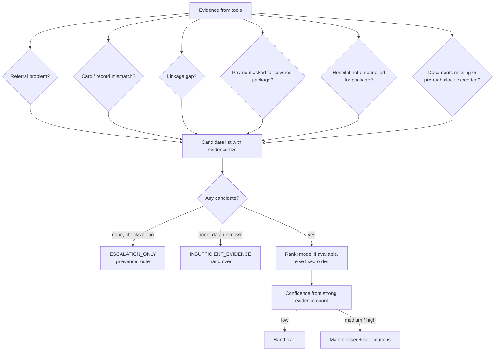

### F9. Verifier loop
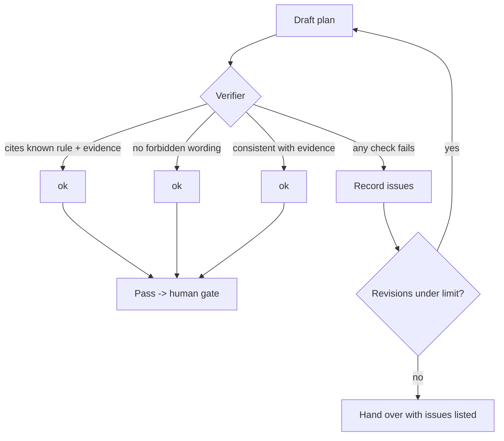

### F10. Data model
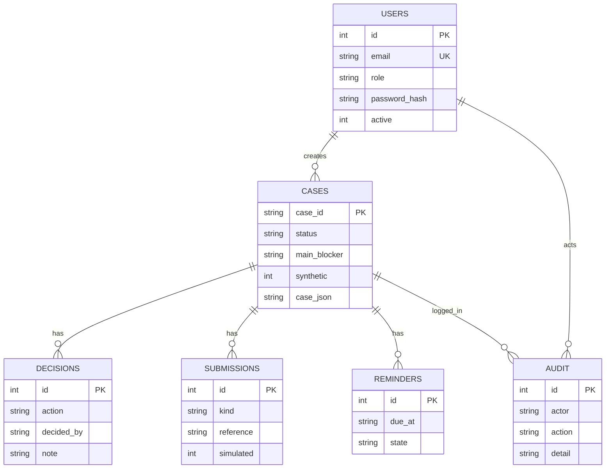

### F11. Frontend routes
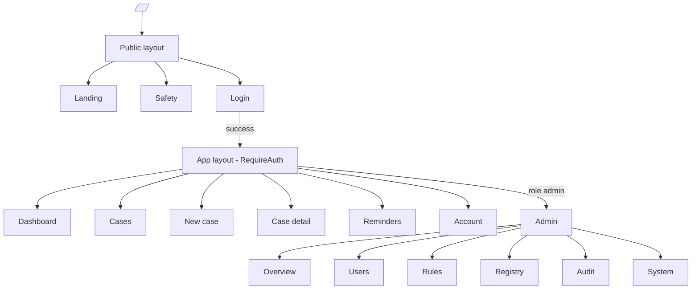

### F12. Deployment on a laptop
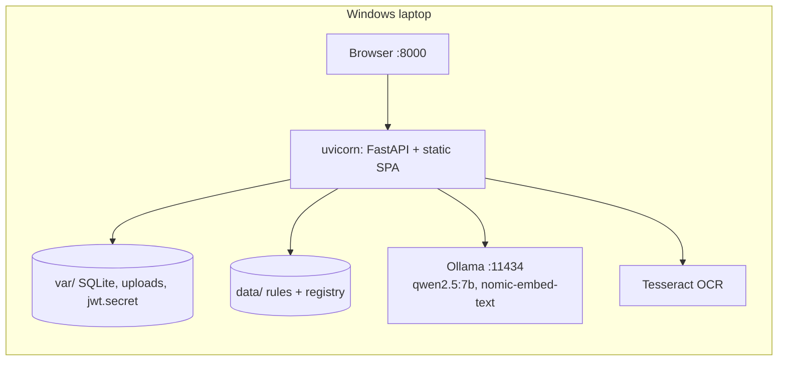

### F13. Team GitHub workflow
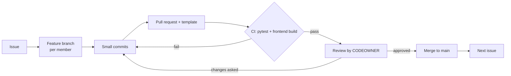

### F14. Hackathon timeline
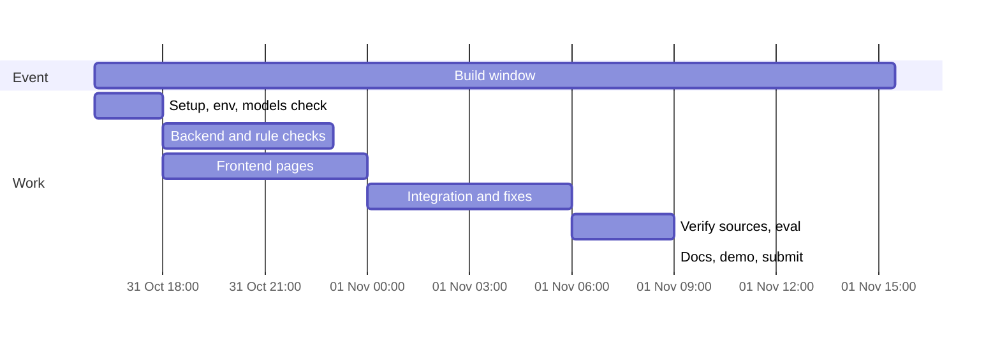
